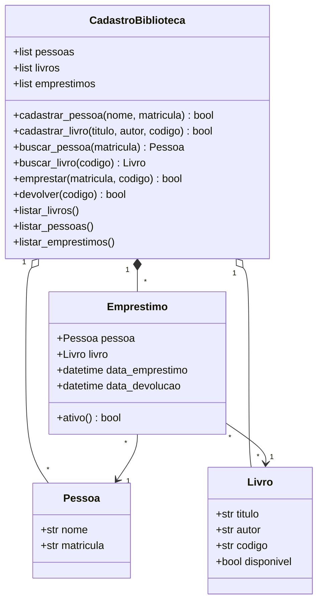

# Diagrama UML

Diagrama de classes do sistema (Mermaid). O GitHub renderiza este bloco automaticamente.
Para exportar como imagem, cole o código em https://mermaid.live e baixe o PNG
(salve como `docs/uml.png`).

## Relacionamentos
- **Agregação (◇):** `CadastroBiblioteca` agrupa `Pessoa` e `Livro`, que existem como entidades próprias.
- **Composição (◆):** `CadastroBiblioteca` é dona dos `Emprestimo`, que só existem dentro do cadastro.
- **Associação (→):** cada `Emprestimo` liga exatamente uma `Pessoa` a um `Livro`.
